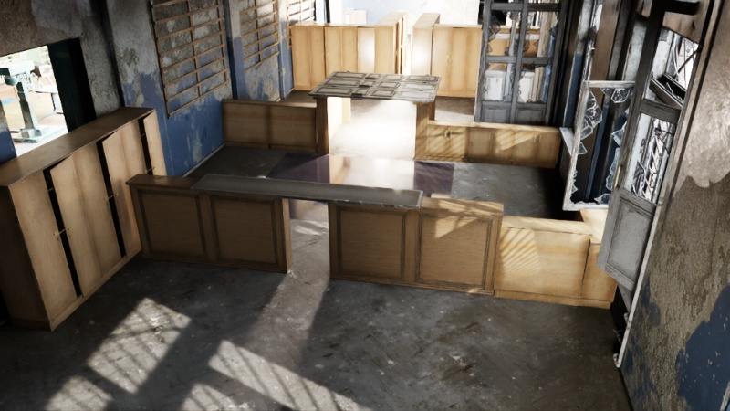

# XFeas

**A learned feasibility layer for off-the-shelf locomotion controllers.**
XFeas sits on top of a robot's existing controller, which it never retrains or modifies. Every 0.25 s it picks which of the
controller's *own* commands to send: forward/lateral speed, body height, pitch, roll and gait or mode. Rules don't decide when
to crouch, sidestep or stand back up: the learned model makes every choice, including its timing. One model is trained across
many controllers and robots. A new controller is handled zero-shot: a short self-test probe measures what its commands
actually do.

<p align="center">
  <br>
  <em>School course (v2a) in the Abandoned School scene, day render. Experiments run at night with only the robot's headlight.</em>
</p>

| G1 + AMO, stock commands | G1 + AMO + XFeas | Spot + ReLIC + XFeas |
|:---:|:---:|:---:|
|  |  |  |
| walks into the 1.10 m lintel: **stuck** | crouches (h 0.3, pitch 1.57) under it: **goal** | lowers its body under it: **goal** |

*Night, headlight only, no map, relative goal, success = within 0.5 m. G1 clips are shown at 3× speed, Spot at 1.5×.*

---

## How it works

```
 head camera (depth) ─► perception ─► clearance map + feasibility features ─┐
                                                                             ├─► XFeas model ─► score every candidate
 controller spec ─► candidate commands (the controller's own command grid) ─┤        (ensemble, pessimistic)
 self-test probe ─► what each command measurably does on THIS controller ───┘                │
                                                                                             ▼
                                         best command, held for 0.25 s ─► off-the-shelf controller ─► robot
```

* **Candidates are the controller's own commands.** They form a fixed grid over the ranges in its spec (speed, height, pitch,
  lateral; discrete modes × speed for modal controllers), plus *keep current* and *stock*. Nothing maps abstract actions
  onto commands by hand.
* **Commands are described by measurement, not by name.** The self-test probe records what each command does on this
  controller: height, width and pitch reached, speed, settle time, tilt, falls. It also records what switching to it at speed
  does. A new controller's "crouch" is comparable to a known one's height command because both are described by measured
  effects.
* **The model scores every candidate** on "hold this for 1.5 s": fall, stall and contact risk, progress, and a learned value.
  A 5-member ensemble gives the uncertainty, and the score is `mean − κ·std`. The choice is made again every 0.25 s, so the
  timing (when to crouch, when to stand) is learned too.
* **Kept engineered** (and disclosed): perception (depth → clearance), steering (the stock relative-goal path follower) and an
  emergency stop once the robot is already falling, which never counts as a success.

**Robots and controllers** (all used as released):

| Robot | Training controllers | Held out (probe only, never trained on) |
|---|---|---|
| Unitree G1 | AMO (`g1c`), GR00T-WBC (`g1g`), Isaac Lab velocity policy (`g1l`), URMA (`g1u`), PHP (`g1p`) | GEAR-SONIC (`g1s`) |
| Boston Dynamics Spot | ReLIC (`spotp`) | Isaac Sim Spot flat-terrain policy (`spotf`) |
| Clearpath Jackal | one wheeled controller | – |
| Iris (Pegasus) | one aerial controller (XFeas picks altitude and speed) | – |

The training set also contains *look-alike* variants of these controllers (`v_*`, `lk_*`, `mm_*`), whose names and specs
match but whose behaviour differs. These force the model to rely on the self-test rather than on names.

---

## Results (preliminary)

School course v2a, cut off 1.5 m after its first overhang (a 0.55 m doorway with a lintel). Night, headlight only, 3 trials
per cell, strict 0.5 m success.

| Robot + controller | Arm | Lintel 1.10 m (`SC2A_O1`) | Lintel 0.85 m (`O1L`) | No lintel (`O1N`) |
|---|---|:---:|:---:|:---:|
| G1 + AMO | stock commands | 0/3 | – | – |
| G1 + AMO | XFeas (all controllers) | **3/3** | **3/3** | **3/3** |
| G1 + AMO | XFeas, **AMO held out** (zero-shot) | 0/3 | 0/3 | 3/3 |
| Spot + ReLIC | XFeas (all controllers) | **3/3** | **3/3** | **3/3** |

No falls in any of these cells. `O1N` is the over-intervention control: there is nothing to crouch under. Zero-shot transfer
to a held-out controller does **not** work yet on this course, and the gym course and terrain-tile evaluations are still
running. These numbers will change.

---

## Repository layout

```
XFeas/
├── env.sh, xfeas_paths.py    machine paths (env vars) + puts every code folder on the import path
├── Scripts/
│   ├── model/                the XFeas model (model5.py), candidates, descriptors, controller registry
│   ├── data_collector/       side-by-side branch collector (run_gen_v5b.py), schedules, suites, audit, queue, self-test probe
│   └── train/                train5b.py (current), train5g4.py, datasets, labels, relocate_data_paths.py
├── closed_loop/              XFeas as a closed-loop method (gen5_methods.py + select_gen5.py), episode runner, courses,
│   │                         launchers p5_cell.sh / gym5_cell.sh / trial.sh, result tables
│   └── baselines/            terrain harnesses + baseline planners (EVORA, VAMOS) used by the evaluations
├── isaac_sim/                robot adapters, camera mount, chase camera, video, GPU wrapper
│   └── controllers/          adapters for AMO, ReLIC Spot, SONIC, PHP, GR00T-WBC, URMA, Isaac Lab G1, Jackal, Iris
├── scenes/                   scene and course builders (school, gym, overhangs, stairs, terrain tiles)
│   ├── assets/school.usd     the baked school scene (references the Abandoned School pack, see Setup)
│   └── courses/              course spec / task JSONs
├── third_party/setup.sh      fetches the released controllers at pinned commits
└── docs/media/               README images
```

Modules import each other by bare name (`import model5`). Each script's first two lines import `xfeas_paths`, which puts every
code folder on `sys.path`, so any script runs from anywhere.

---

## Setup

**1. Software**
* [Isaac Sim 5.1](https://docs.isaacsim.omniverse.nvidia.com/) (simulation, rendering). Isaac Lab 2.3 is needed only for the
  terrain tiles.
* A Python 3.11 environment with PyTorch (CUDA), numpy and opencv for training and the model server (`XFEAS_PY`).
* Edit the paths at the top of **`env.sh`** (Isaac Sim's `python.sh`, the Python environments). The launchers source it; source
  it yourself before running anything by hand:
  ```bash
  source env.sh
  ```

**2. Released controllers**
```bash
bash third_party/setup.sh        # AMO, GR00T-WholeBodyControl, php_parkour, relic, mppi_numba, vamos, PegasusSimulator, GEAR-SONIC
```
Then unpack the **XFeas extras** into `third_party/`. They hold the robot USDs we converted from each controller's own
MJCF/URDF (`AMO/usd`, `relic/usd`, `php_parkour/usd`, `GEAR-SONIC/usd`, `GR00T-WBC/`) and the VAMOS adapter
(`vamos/arl_adapter`). *(Download link: TBA.)*

**3. Scene assets**
* **Abandoned School pack:** place (or symlink) it at `third_party/scene_assets/Collected_Abandoned_school_showcase`, which is
  where `scenes/assets/school.usd` looks. If it lives elsewhere, re-point the scene once:
  ```bash
  $ISAACSIM_PYTHON scenes/relink_school_usd.py --pack /path/to/Collected_Abandoned_school_showcase
  ```
* **Isaac Sim asset mirror** (environments, vegetation, sky HDRs; terrain tiles and the warehouse/office environments): set
  `XFEAS_ISAAC_ASSETS` in `env.sh`.

**4. Data and checkpoints**
Download into `data/` *(link: TBA)*: controller specs and self-test probes, the gen5b dataset, the gen4 initialisation
weights and the trained XFeas checkpoints. The data files store absolute paths from the machine that wrote them. Re-point
them once:
```bash
$XFEAS_PY Scripts/train/relocate_data_paths.py            # dry run
$XFEAS_PY Scripts/train/relocate_data_paths.py --apply
```

---

## Usage

All commands run from the repo root after `source env.sh`. **GPU:** the launchers pin everything to GPU 0.

**Train XFeas** (gen5b side-by-side branches + gen4 side-by-side options; initialised from the gen4 context encoder):
```bash
$XFEAS_PY Scripts/train/train5b.py --out data/gen_train/gen5b/runs/all \
    --gen4-ckpt data/gen_train/gen4/full/f_none/ckpt/xfeas_gen4_ens.pt
# hold a controller out (zero-shot test), e.g. AMO:
$XFEAS_PY Scripts/train/train5b.py --out data/gen_train/gen5b/runs/g1c_ho --holdout-base g1c \
    --gen4-ckpt data/gen_train/gen4/full/f_g1c/ckpt/xfeas_gen4_ens.pt
# offline evaluation
$XFEAS_PY Scripts/train/train5b.py --eval-only --ckpt data/gen_train/gen5b/runs/all/model.pt --eval-split val
```
`Scripts/train/run5b.sh` runs the full sequence (held-out fold, evaluations, all-controllers model) with restarts.

**Check a trained model offline** (descriptor parity + candidate scores against the training data, CPU is fine):
```bash
$XFEAS_PY closed_loop/select_gen5.py --selftest --ckpt data/gen_train/gen5b/runs/all/model.pt --device cpu
```

**Closed loop in Isaac Sim** (school course, first overhang):
```bash
# closed_loop/p5_cell.sh <job id> <amo|spot|sonic> <stock|g5b|g5bho> <trials> [SC2A_O1|SC2A_O1L|SC2A_O1N]
bash closed_loop/p5_cell.sh demo_amo amo g5b 1 SC2A_O1
```
Results go to `data/gen5_closed/course/<job id>/runs_<robot>.jsonl`, videos to `data/gen5_closed/videos/`.
Other courses: `closed_loop/gym5_cell.sh` (gym obstacle course) and `closed_loop/trial.sh` (terrain tiles).

**Self-test a controller** (the probe that lets XFeas use a controller it never saw):
```bash
Scripts/data_collector/run_isaac5.sh 0 Scripts/data_collector/probe_transitions5.py --base g1c --ctrls g1c
```

**Collect side-by-side branch data**:
```bash
python Scripts/data_collector/make_suite5b.py --groups a,b,c --write-jobs   # situations + jobs
$XFEAS_PY Scripts/data_collector/queue5b.py                                 # runs the jobs (GPU 0), audits each one
# one job by hand:
Scripts/data_collector/run_isaac5.sh 0 Scripts/data_collector/run_gen_v5b.py --env school --base g1c \
    --suite data/gen_v5b/suites/school_g1c_b1.json --chunk 0:4 --part school_g1c_b1_0000
$XFEAS_PY Scripts/train/dataset5b.py build --out data/gen_train/gen5b/manifest.jsonl
```
Each situation is replayed from the same saved moment with different commands: switch at several distances, hold vs stand up
once crouched, and scenes with nothing to avoid. Every training sample therefore answers a concrete "which command, now?"
question.

---

## Acknowledgements

XFeas runs on top of released controllers, used unmodified:
[AMO](https://github.com/OpenTeleVision/AMO), [GEAR-SONIC](https://huggingface.co/nvidia/GEAR-SONIC),
[GR00T-WholeBodyControl](https://github.com/NVlabs/GR00T-WholeBodyControl), [PHP](https://github.com/amazon-far/php_parkour),
[ReLIC](https://github.com/rai-opensource/relic), URMA, the Isaac Lab G1 velocity policy, and
[Pegasus Simulator](https://github.com/PegasusSimulator/PegasusSimulator). The baselines are
[VAMOS](https://github.com/vamos-vla/vamos) and EVORA ([mppi_numba](https://github.com/mit-acl/mppi_numba)). Each keeps its own
license.
