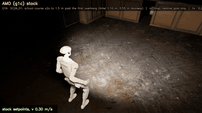
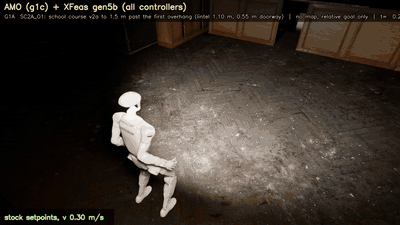
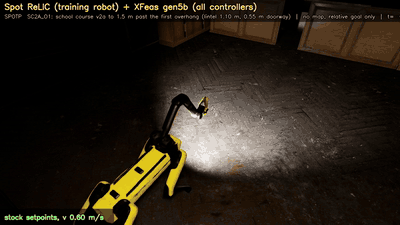

# XFeas

**A learned feasibility layer for off-the-shelf locomotion controllers.**

A robot already has a walking controller (AMO, ReLIC, SONIC, ...). XFeas does not change or retrain it. Every 0.25 s, XFeas
looks at the robot's head camera and picks which of the controller's **own commands** to send: walk normally, slow down,
crouch or crawl, sidestep, stand back up. A neural network (the **feasibility model**) predicts what each command would lead
to over the next 1.5 s (fall, stall, hitting something, reaching the goal). Simple geometric rules decide **when** to switch
to a crouch or sidestep and how to stand back up; the model decides **which** of the controller's commands to use.

| G1 + AMO, stock commands | G1 + AMO + XFeas | Spot + ReLIC + XFeas |
|:---:|:---:|:---:|
|  |  |  |
| walks into the 1.10 m lintel: **stuck** | crouches under it: **reaches the goal** | lowers its body under it: **reaches the goal** |

*Night, headlight only, no map, goal given relative to the robot, success = within 0.5 m with no fall. G1 clips at 3×
speed, Spot at 1.5×.*

New to the code? Read **[docs/CODEBASE.md](docs/CODEBASE.md)**: what every folder and file does.

---

## Quick start

```bash
git clone <this repo> && cd XFeas
pip install -e .                    # in your PyTorch environment
# edit the paths at the top of env.sh for your machine (see "Setup"), then:
source env.sh
bash third_party/setup.sh           # fetch the released controllers
# download data/ and the extras (see "Data"), then:
python tools/relocate_data_paths.py --apply

python evaluate.py model --ckpt data/gen_train/gen5b/runs/all/model.pt --device cpu   # offline check, no simulator
python evaluate.py school demo sonic g5sm 1                                            # one episode in Isaac Sim
```

---

## How it works

```
 head camera (depth) ─► perception ─► clearance map + body state ──────────┐
 controller spec ─► candidate commands (the controller's own command grid) ─┼─► XFeas network ─► best command
 controller self-test ─► what each command measurably does ─────────────────┘   (every 0.25 s)      │
                                                                                                     ▼
                                                             off-the-shelf controller ─► robot (Isaac Sim)
```

1. **Candidates are the controller's own commands**: a grid over its speed, body height, pitch and lateral ranges (or its
   discrete modes), plus "keep the current command" and "stock command".
2. **Each command is described by measurement, not by name.** A short **self-test** runs on every controller and records
   what each command physically does (height reached, speed, tilt, falls, how safe switching is at speed).
3. **The network scores every candidate** for "hold this for 1.5 s": fall, stall and contact risk, progress and success.
   Five ensemble heads give an uncertainty; the score is `mean − κ·std − λ·P(fall)`, so XFeas is cautious when unsure.
4. **Rules decide when, the model decides what.** From the head-camera points, the skill rules
   (`xfeas/closed_loop/skill_rules.py`) detect overhangs and narrow gaps ahead and decide when to switch skill
   (walk / crouch-crawl / sidestep) and how to stand back up (stop low, then rise in place). The model picks the move.
   Every rule threshold is a margin of the robot's self-test measurements, not tuned on test scenes.
5. **Steering is never learned**: the same path follower steers every method, so results compare only the command choice.
6. **Training data is side by side**: the simulator state is saved at a moment before an obstacle and replayed with
   different commands, so the real outcome of every option from the same state is known.

**Robots and controllers** (all used as released, never retrained):

| Robot | Controllers | Notes |
|---|---|---|
| Unitree G1 | AMO (`g1c`), GR00T-WBC (`g1g`), Isaac Lab policy (`g1l`), URMA (`g1u`), PHP (`g1p`), GEAR-SONIC (`g1s`) | SONIC is in training (model `all_g1s_v4`) |
| Boston Dynamics Spot | ReLIC (`spotp`), Isaac Sim flat-terrain policy (`spotf`) | `spotf` held out |
| Clearpath Jackal, Iris drone | one controller each | |

Training also uses *look-alike* variants of these controllers (same name and spec, different behaviour), which force the
model to rely on the self-test rather than on names.

---

## Repository layout

```
XFeas/
├── train.py  evaluate.py  collect.py  probe.py     ← the four entry points (start here)
├── env.sh                    machine paths (Isaac Sim, Python environments, third-party code)
├── xfeas/                    the code (a Python package)
│   ├── model/                the network, candidate commands, command descriptors, controller registry
│   ├── data_collection/      side-by-side data collection in Isaac Sim, controller self-test, job queue
│   ├── train/                datasets, labels, training
│   ├── closed_loop/          running XFeas in full episodes, model server, evaluation scenes and launchers
│   ├── sim/                  robots and controllers in Isaac Sim, cameras, video
│   ├── scenes/               scene and course builders (school, gym, overhangs, stairs, terrain)
│   ├── paths.py              machine paths for Python (read from env.sh variables)
│   └── _support/             earlier model generations the current code builds on (you don't need to read these)
├── baselines/                comparison methods (VAMOS, EVORA, ...) run through the same evaluation
├── tools/                    result tables, diagnostic videos, data / scene path fixes
├── assets/                   the school scene (school.usd) and course definitions
├── third_party/setup.sh      fetches the released controllers
└── docs/                     codebase guide, README media
```

Every Python file starts with `import xfeas`, which puts all code folders on the import path; modules then import each
other by plain name (`import feasibility_model`).

---

## Setup

### 1. Software

| What | Why |
|---|---|
| [Isaac Sim 5.1](https://docs.isaacsim.omniverse.nvidia.com/) | simulation and rendering |
| Python 3.10+ with PyTorch (CUDA), numpy, opencv | training and the model server (`pip install -e .` installs the package) |
| A second Python env with `onnxruntime` | the SONIC / PHP / GR00T policy servers (`GR00T_PY`) |
| Isaac Lab 2.3 (optional) | terrain tiles only |

The simulator and the model run in **two separate processes**: Isaac Sim's Python runs the robot, your PyTorch Python runs
the network (`xfeas/closed_loop/model_server.py`), and they talk over stdin/stdout.

### 2. `env.sh`

Edit the defaults at the top of `env.sh`, then `source env.sh` in every new shell (the launchers source it themselves).

| Variable | Meaning |
|---|---|
| `ISAACSIM_PYTHON` | Isaac Sim's `python.sh` |
| `XFEAS_PY` | your PyTorch Python |
| `GR00T_PY` | the Python with onnxruntime for the SONIC / PHP / GR00T servers |
| `ISAACLAB_PY` | Isaac Lab venv Python (terrain tiles only) |
| `XFEAS_BASELINES` | where the released controllers are (default `third_party/`) |
| `XFEAS_ISAAC_ASSETS` | Isaac Sim asset mirror (environments, vegetation, sky HDRs) |
| `XFEAS_SCENE_ASSETS` | folder that holds `Collected_Abandoned_school_showcase` (default `third_party/scene_assets/`) |

### 3. Released controllers

```bash
bash third_party/setup.sh     # AMO, GR00T-WholeBodyControl, php_parkour, relic, mppi_numba, vamos, PegasusSimulator, GEAR-SONIC
```
Then unpack the **XFeas extras** into `third_party/`: the robot USDs we converted from each controller's own MJCF/URDF
and the VAMOS adapter. *(Download link: TBA.)*

### 4. School scene

Put (or symlink) the Abandoned School asset pack at `third_party/scene_assets/Collected_Abandoned_school_showcase`. That is
where `assets/school.usd` looks. If the pack is elsewhere, re-point the scene once:
```bash
$ISAACSIM_PYTHON tools/relink_school_usd.py --pack /path/to/Collected_Abandoned_school_showcase
```

### 5. Data

Download into `data/` *(link: TBA)*, then re-point the absolute paths stored in the data files:
```bash
python tools/relocate_data_paths.py            # dry run: shows what will change
python tools/relocate_data_paths.py --apply
```

| Path | Contents |
|---|---|
| `data/gen_v5/specs/`, `data/gen_v4/specs/` | controller specs (each controller's command interface) |
| `data/probes_v5/`, `data/probes_v4/` | controller self-test results |
| `data/gen_v5b/` | collected side-by-side training data |
| `data/gen_train/gen5b/manifest.jsonl` | training index |
| `data/gen_train/gen4/full/*/ckpt/xfeas_gen4_ens.pt` | earlier weights the network starts from |
| `data/gen_train/gen5b/runs/all_g1s_v4/model.pt` | **current trained XFeas** (all controllers incl. SONIC) |
| `data/gen_train/gen5b/runs/all/model.pt`, `g1c_ho/` | earlier model without SONIC; `g1c_ho` = trained without AMO |

---

## Usage

All commands run from the repo root after `source env.sh`. Isaac Sim jobs run on **GPU 0**.

### Train
```bash
python train.py --out data/gen_train/gen5b/runs/all \
    --gen4-ckpt data/gen_train/gen4/full/f_none/ckpt/xfeas_gen4_ens.pt
python train.py --out data/gen_train/gen5b/runs/g1c_ho --holdout-base g1c \
    --gen4-ckpt data/gen_train/gen4/full/f_g1c/ckpt/xfeas_gen4_ens.pt          # leave AMO out
python train.py --eval-only --ckpt data/gen_train/gen5b/runs/all/model.pt --eval-split val
```
Outputs: `model.pt`, `last.pt` (for resuming), `norm.json`, `train.log` in `--out`.
* The current model (`all_g1s_v4`, with SONIC) is trained on the v4 manifest:
  `python xfeas/train/build_manifest_v4.py ...` (filters the data and runs a quality check; exit 1 = don't train), then
  `train.py --manifest data/gen_train/gen5b/manifest_g1s_v4.jsonl ...`. The whole chain (collect → manifest + check → train
  → closed-loop test) is `bash xfeas/train/run_sonic_retrain.sh`.
* `bash xfeas/train/run_training.sh` runs the earlier sequence (held-out model, evaluations, all-controllers model).

### Evaluate
```bash
python evaluate.py model --ckpt data/gen_train/gen5b/runs/all_g1s_v4/model.pt --device cpu   # offline check, no simulator
python evaluate.py school <job id> <amo|spot|sonic> <arm> <trials> [scene]
python evaluate.py gym    <job id> <amo|sonic> <GC2F|CC1F> <trials>
python evaluate.py terrain <spot|amo> <tile> <trial index> <out dir>
```
* Arms (`xfeas/closed_loop/run_school_cell.sh` lists them all):

  | Arm | What runs |
  |---|---|
  | `stock` | the controller's default commands |
  | **`g5sm`** | **current method**: rules decide when + stand-up, the model picks the move (model `all_g1s_v4`) |
  | `g5smP` | `g5sm` + SONIC execution helpers (`sonic_primitives.py`: turn in place, hold heading / lateral position) |
  | `g5smC`, `g5smCF` | `g5sm` with course-safe timing |
  | `g5sr` | rules pick the skill, the model ranks the commands inside it |
  | `g5sr0` | rules only, no model (ablation) |
  | `g5s` | model only, no rules (with SONIC) |
  | `g5b`, `g5bho` | earlier model without SONIC; `g5bho` trained without AMO |
* Scenes: `SC2A` full school course; `SC2A_O1` its first doorway (lintel 1.10 m), `SC2A_O1L` lintel lowered to 0.85 m,
  `SC2A_O1N` no lintel (checks XFeas doesn't crouch for nothing); `D1g` raised door (crouch), `HW1` blocked hallway
  (sidestep), `GC2F` gym course.
* `P5_GPU=1` runs a cell on GPU 1 (default GPU 0).
* Results: `data/gen5_closed/course/<job id>/runs_<robot>.jsonl` (one row per trial: `success`, `outcome`, `t_end`,
  `max_tilt_deg`, ...), videos in `data/gen5_closed/videos/`, decision logs in `data/gen5_closed/diag/<job id>/`.
* Whole school matrix: `bash xfeas/closed_loop/run_school_matrix.sh`, summary: `python tools/summarize_school_matrix.py`.

### Collect training data
```bash
python xfeas/data_collection/make_suites.py --groups a,b,c --write-jobs   # scenes + job list
python xfeas/data_collection/job_queue.py                                 # runs every job on GPU 0, audits each
python collect.py --env school --base g1c --suite data/gen_v5b/suites/school_g1c_b1.json \
    --chunk 0:4 --part school_g1c_b1_0000                                 # or one job by hand
python xfeas/train/branch_dataset.py build --root data/gen_v5b --out data/gen_train/gen5b/manifest.jsonl
```

### Self-test a controller
```bash
python probe.py --base g1c --ctrls g1c
```

---

## Results (preliminary)

Earlier model (`g5b`, trained without SONIC, model-only), school course, first doorway. Night, headlight only, 3 trials per
cell, strict 0.5 m success, no falls in any cell. Results for the current method (`g5sm`) are being collected.

| Robot + controller | Arm | Lintel 1.10 m | Lintel 0.85 m | No lintel |
|---|---|:---:|:---:|:---:|
| G1 + AMO | stock | 0/3 | – | – |
| G1 + AMO | XFeas (`g5b`) | **3/3** | **3/3** | **3/3** |
| G1 + AMO | XFeas trained without AMO (`g5bho`) | 0/3 | 0/3 | 3/3 |
| Spot + ReLIC | XFeas (`g5b`) | **3/3** | **3/3** | **3/3** |

---

## Troubleshooting

| Problem | Fix |
|---|---|
| `ModuleNotFoundError: No module named 'xfeas'` | `pip install -e .` in that Python, or `source env.sh` (adds the repo to `PYTHONPATH`) |
| a controller's files are missing | `bash third_party/setup.sh` and unpack the extras into `third_party/` |
| the school scene loads empty or grey | the asset pack is not at `third_party/scene_assets/...`: run `tools/relink_school_usd.py` |
| `FileNotFoundError` under `/p/...` or another machine's path | `python tools/relocate_data_paths.py --apply` |

---

## Acknowledgements

XFeas runs on top of released controllers, used unmodified:
[AMO](https://github.com/OpenTeleVision/AMO), [GEAR-SONIC](https://huggingface.co/nvidia/GEAR-SONIC),
[GR00T-WholeBodyControl](https://github.com/NVlabs/GR00T-WholeBodyControl), [PHP](https://github.com/amazon-far/php_parkour),
[ReLIC](https://github.com/rai-opensource/relic), URMA, the Isaac Lab G1 velocity policy and
[Pegasus Simulator](https://github.com/PegasusSimulator/PegasusSimulator). Baselines: [VAMOS](https://github.com/vamos-vla/vamos)
and EVORA ([mppi_numba](https://github.com/mit-acl/mppi_numba)). Each keeps its own license.
